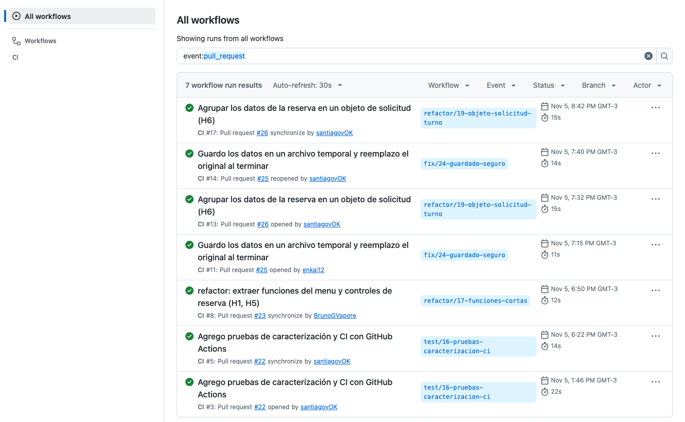

# Pruebas y verificación del comportamiento

Para comprobar que los refactorings no cambian el comportamiento de la versión inicial (`estado-inicial`), armamos una suite de pruebas de caracterización con `unittest`, usando datos fijos en memoria y archivos temporales (`tempfile.TemporaryDirectory`) para no tocar `datos/local.json` ni `datos/ejemplo.json`.

## Qué cubren las pruebas

La suite final sobre el commit `465cc5e` tiene **20 pruebas** repartidas en tres archivos:

| Archivo | Pruebas | Qué comprueba |
|---|---|---|
| `tests/test_pacientes.py` | 3 | Alta con los espacios recortados y nombres iguales con identificadores distintos, rechazo de nombre vacío o con solo espacios sin cambiar los datos, y listado ordenado por número sin cambiar la lista original. |
| `tests/test_turnos.py` | 12 | Reserva válida y avance de `proximo_turno`, reserva en las 6 franjas de `FRANJAS`, rechazo de 8 entradas inválidas sin cambiar los datos, profesional o paciente ocupado, orden del mensaje ante doble conflicto en turnos distintos, cancelación y liberación de franja, cancelación inválida, estructura de `agenda_profesional` y orden e historial de paciente con desempate por número de turno. |
| `tests/test_persistencia.py` | 5 | Guardar y recargar conservando todos los datos y acentos, creación de `local.json` desde `ejemplo.json` si no existe, preservación de archivos ante JSON mal escrito, guardado con error sin modificar el archivo anterior ni dejar `.tmp`, y flujo completo de reservar, guardar, recargar y consultar agenda e historial. |

## Cómo correrlas en local

Las corrimos en macOS y Windows con Python 3.13.18, Black 26.10.0 y flake8 7.4.1, las versiones de requirements-dev.txt. En GitHub Actions, el workflow usa Python 3.13 en ubuntu-latest y corre, en este orden, Black, flake8 y unittest en cada push y en cada Pull Request. No tiene otros pasos.

## Salida de las 20 pruebas

Resultado de ejecutar `python -m unittest discover -s tests -v` sobre el commit `465cc5e`:

```text
test_listar_pacientes_orden_numerico_y_no_muta_original (test_pacientes.TestPacientes.test_listar_pacientes_orden_numerico_y_no_muta_original)
Devuelve pacientes ordenados por ID sin alterar el orden original. ... ok
test_registrar_paciente_con_espacios_y_nombres_duplicados (test_pacientes.TestPacientes.test_registrar_paciente_con_espacios_y_nombres_duplicados)
Registra pacientes recortando espacios y permite nombres duplicados. ... ok
test_registrar_paciente_rechaza_nombres_vacios_o_espacios (test_pacientes.TestPacientes.test_registrar_paciente_rechaza_nombres_vacios_o_espacios)
Rechaza altas con cadenas vacías o solo espacios sin alterar datos. ... ok
test_cargar_crea_destino_desde_ejemplo (test_persistencia.TestPersistencia.test_cargar_crea_destino_desde_ejemplo)
Cargar crea el archivo destino a partir del ejemplo si no existe. ... ok
test_cargar_json_invalido_no_reemplaza_destino (test_persistencia.TestPersistencia.test_cargar_json_invalido_no_reemplaza_destino)
Cargar un archivo con JSON inválido propaga error y preserva archivos. ... ok
test_guardar_con_error_no_modifica_destino (test_persistencia.TestPersistencia.test_guardar_con_error_no_modifica_destino)
Si el guardado falla, el archivo anterior queda igual y sin temporales. ... ok
test_guardar_y_recargar_conserva_datos (test_persistencia.TestPersistencia.test_guardar_y_recargar_conserva_datos)
Guardar y recargar conserva la totalidad de los datos y caracteres. ... ok
test_reserva_persistida_aparece_en_agenda_e_historial (test_persistencia.TestPersistencia.test_reserva_persistida_aparece_en_agenda_e_historial)
Una reserva guardada y recargada se refleja en agenda e historial. ... ok
test_agenda_profesional_estructura_ocupacion_y_cancelacion (test_turnos.TestTurnos.test_agenda_profesional_estructura_ocupacion_y_cancelacion)
Agenda devuelve las 6 franjas ordenadas, refleja ocupación y cancelados. ... ok
test_agenda_profesional_invalida_no_muta_datos (test_turnos.TestTurnos.test_agenda_profesional_invalida_no_muta_datos)
Consultar agenda con profesional inexistente o fecha inválida no muta. ... ok
test_cancelacion_invalida_no_muta_datos (test_turnos.TestTurnos.test_cancelacion_invalida_no_muta_datos)
Cancelar un turno inexistente o ya cancelado falla sin alterar datos. ... ok
test_cancelacion_libera_franja_y_conserva_historial (test_turnos.TestTurnos.test_cancelacion_libera_franja_y_conserva_historial)
Cancelar actualiza a CANCELADO y permite reservar de nuevo esa franja. ... ok
test_conflictos_y_concurrencia_de_franjas (test_turnos.TestTurnos.test_conflictos_y_concurrencia_de_franjas)
Superposiciones se rechazan sin mutar; combinaciones libres se permiten. ... ok
test_historial_paciente_desempate_por_id (test_turnos.TestTurnos.test_historial_paciente_desempate_por_id)
Ante misma fecha y hora, el historial desempata por ID ascendentemente. ... ok
test_historial_paciente_filtro_y_ordenamiento (test_turnos.TestTurnos.test_historial_paciente_filtro_y_ordenamiento)
Historial filtra por paciente, incluye cancelados y ordena ... ok
test_historial_paciente_invalido_no_muta_datos (test_turnos.TestTurnos.test_historial_paciente_invalido_no_muta_datos)
Consultar historial con paciente inexistente devuelve False y no muta. ... ok
test_precedencia_mensaje_conflictos_en_turnos_distintos (test_turnos.TestTurnos.test_precedencia_mensaje_conflictos_en_turnos_distintos)
El orden de los turnos determina el mensaje ante dos conflictos. ... ok
test_rechazo_entradas_invalidas_no_muta_datos (test_turnos.TestTurnos.test_rechazo_entradas_invalidas_no_muta_datos)
Casos inválidos devuelven False y preservan los datos intactos. ... ok
test_reserva_valida_crea_turno_y_avanza_contador (test_turnos.TestTurnos.test_reserva_valida_crea_turno_y_avanza_contador)
Una reserva válida crea el registro ACTIVO y avanza proximo_turno. ... ok
test_reserva_valida_en_todas_las_franjas (test_turnos.TestTurnos.test_reserva_valida_en_todas_las_franjas)
Cada una de las franjas horarias válidas permite reservar con éxito. ... ok

----------------------------------------------------------------------
Ran 20 tests in 0.020s

OK
```

## Salida de Black y flake8

```
python -m black --check .
All done! ✨ 🍰 ✨
8 files would be left unchanged.
python -m flake8 .
```
flake8 no muestra nada cuando no encuentra problemas y termina con código 0.


## Comparación de salida e integración continua

Además de las pruebas con `unittest`, sobre el commit `465cc5e` corrimos la demo completa, los dieciséis casos de borde, el caso de H11 y el doble conflicto, y los comparamos contra `estado-inicial`: dieron las mismas 403 líneas de salida por consola y el mismo archivo JSON final.

En GitHub Actions (`.github/workflows/ci.yml`), cada push y cada Pull Request corre `unittest`, `black --check .` y `flake8 .`. H2 (PR #20) y H3 (PR #21) se integraron antes de que existieran las pruebas automatizadas, así que los comprobamos comparando la salida con la de estado-inicial. Las pruebas se escribieron en paralelo, sobre la versión inicial. La suite empezó con 18 pruebas al abrir el PR #22 y se integró con 19, porque antes del merge se sumó la prueba del orden del mensaje ante doble conflicto. Llegó a 20 en el PR #25, con la prueba del guardado fallido, y en el PR #26 se adaptaron las llamadas a SolicitudTurno sin cambiar ningún resultado esperado. 

Las ejecuciones sobre 465cc5e que muestra este documento son posteriores a todos los refactorings:
